# Index

## [Introduction](#introduction-1)

- [Why is this a method?](#why-is-this-a-method)
- [Whats a modifier](#whats-a-modifier)

## [Nidus Loadout](#nidus-loadout-1)

- [Nidus Build](#build)
- [Archon shards](#archon-shards)
- [Glaxion vandal](#glaxion-vandal)
- [Ripkas](#ripkas)
- [Aksondal](#aksondal)
- [Aksondal Guide](#aksondal-guide)

## [Nidus Procedure](#nidus-procedure-1)

## [Nidus Example Runs](#nidus-gameplay)

## [Khora Loadout](#khora-loadout-1)

- [Khora Build](#build-1)
- [Archon shards](#archon-shards-1)
- [Prisma Skana](#prisma-skana)

## [Khora Procedure](#khora-procedure-1)

## [Khora Example Runs](#khora-gameplay)

## [Credits](#credits)

---

# Introduction

## Why is this a method?

Why should you one pull? The runs are around 1 second faster per wave which adds up. Additionally it has more room for error in terms of larva placement and is easier to know where to pull. The downside is it requires more skill from both the nidus and khora.

## Whats a modifier?

a modifier can be one of 3 randomly picked options that change a run, you can see which of the 3 modifiers it is at the beginning of the round. Most players with group these modifiers into 2 groups, non-rein (TE and Rad) and rein (reinforcement).
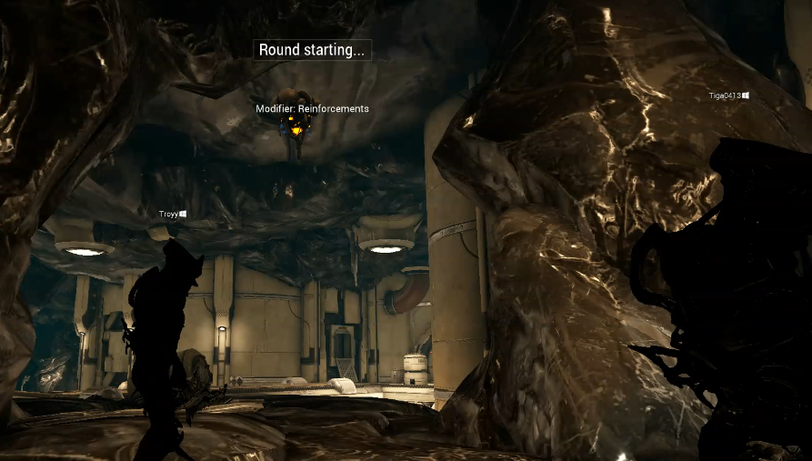
- Reinforcement (AKA Rein)
- Tougher Enemies (AKA TE)
- Reduced Ability Duration (AKA Rad)

---

## Nidus Loadout

### Build

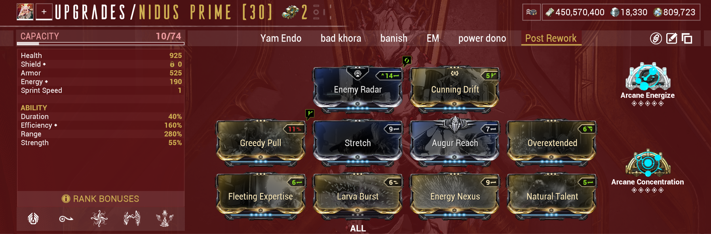

### Archon shards

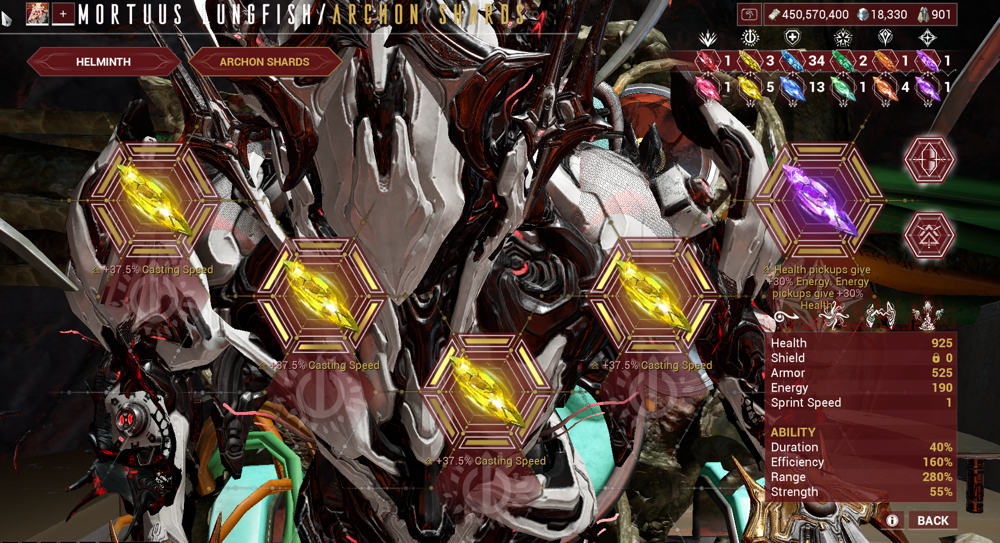

### Glaxion vandal

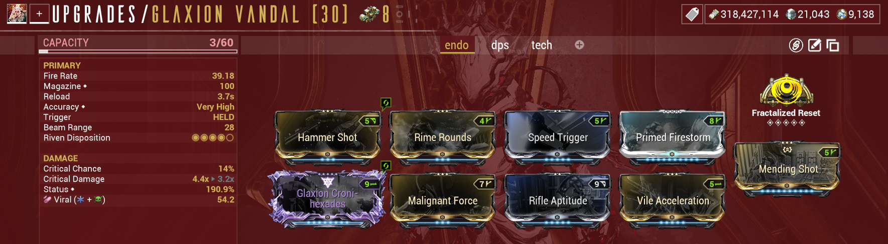

### Ripkas

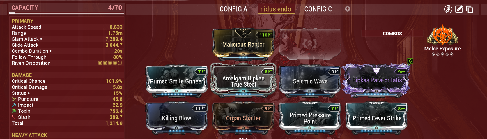

### Aksondal

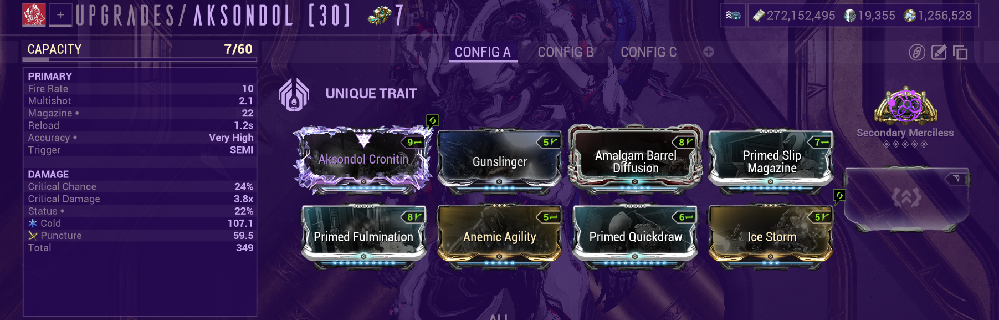

### Notes

- Glaxion riven and full build are optional but allows for less delays between waves, resulting in faster waves
- Glaxion riven is fr sc -harmless stat (no riven runs catalyzer link)
- Ripkas riven is cc ic md -harmless stat (no riven runs corrupt charge)
- Aksondal is optional, mostly used for nidus or khora who are worse at the strategy and cant insta flick, this will be explained upon further in the guide
- Aksondal riven is mc fr -harmless stat (no riven drops the riven for lethal torrent and drops primed quickdraw for tainted clip)
---

# Nidus Procedure

1. do rollout like normal
2. once you pull the enemies to the bridge, heavy slam them
3. grab health orb over here with your glaxion, you may have to jump slightly towards it
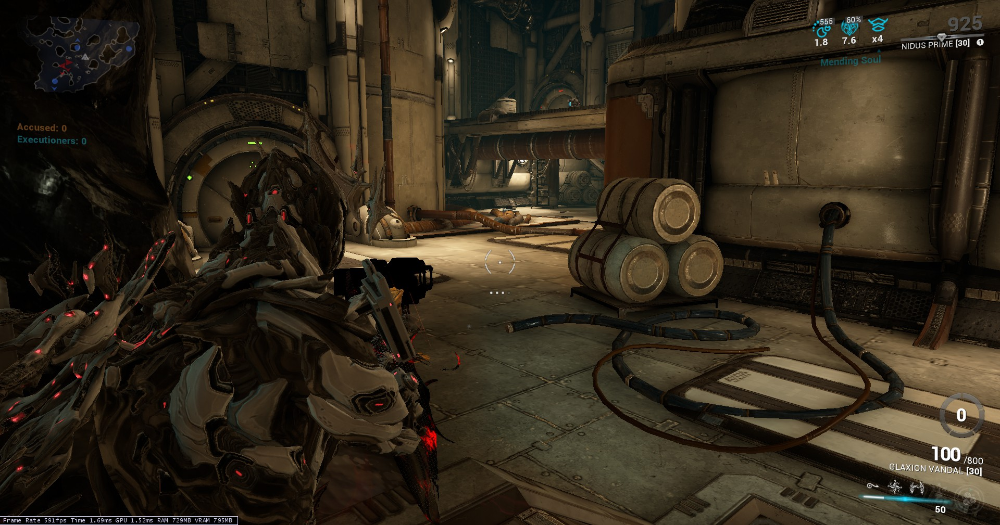
4. move onto this lamp shown below
5. look at this afk spot to manipulate the enemy spawns
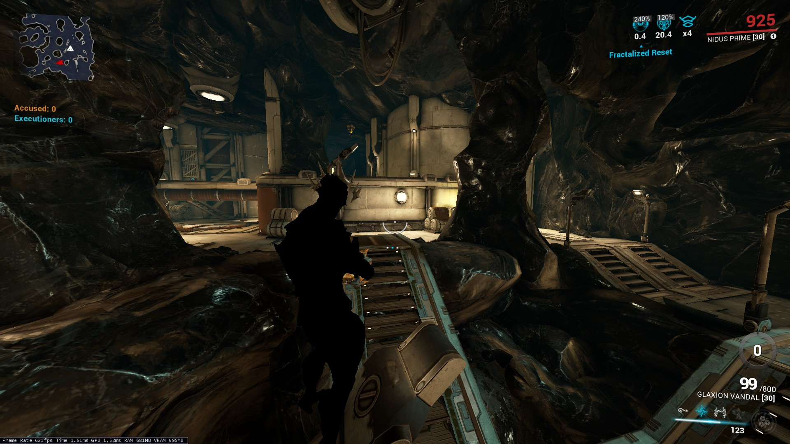
6. move to the center of the lamp and look down and sling yourself so you dont die
6.a if you're insta flicking you'll want to move yourself to the right part of the lamp to prevent hitting the lamp on your flicks
7. once all enemies have spawned, turn around and throw your larva here if you hit your khora it doesn't matter, in fact it may be better as you get better line of sight on the enemies. (While turning and casting is okay, it causes a higher chance of enemies walking off, which causes missing enemies. Ideally, you would look at the afk spot, when enemies spawn press 2 then flick your mouse to the spot, as shown in the example run)
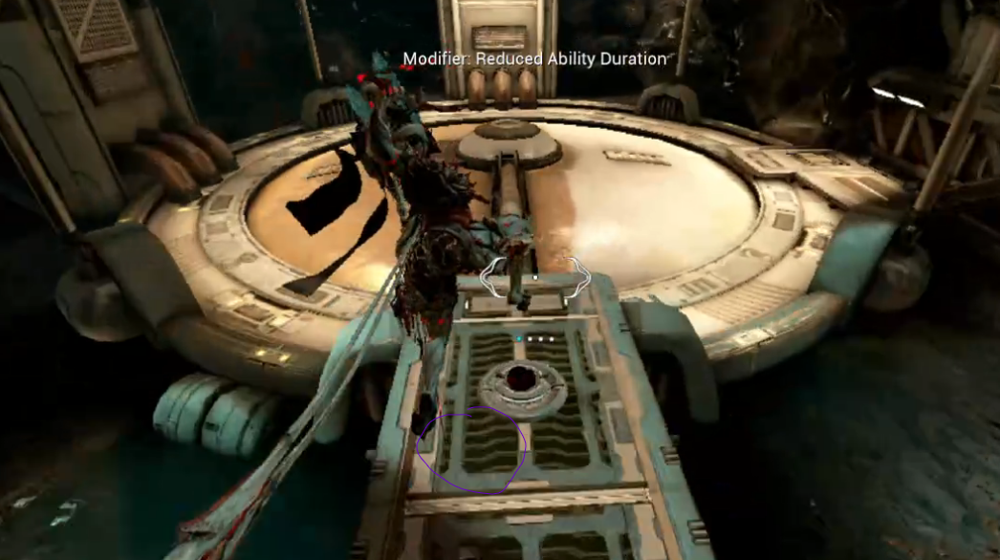
8. pop your lake larva the second you see that the farthest enemy  from the lake spot starts moving which is almost always these spawns circled in black, not doing this will cause the enemies to either not have enough momentum or too much momentum. If these enemies do not spawn you can insta pop
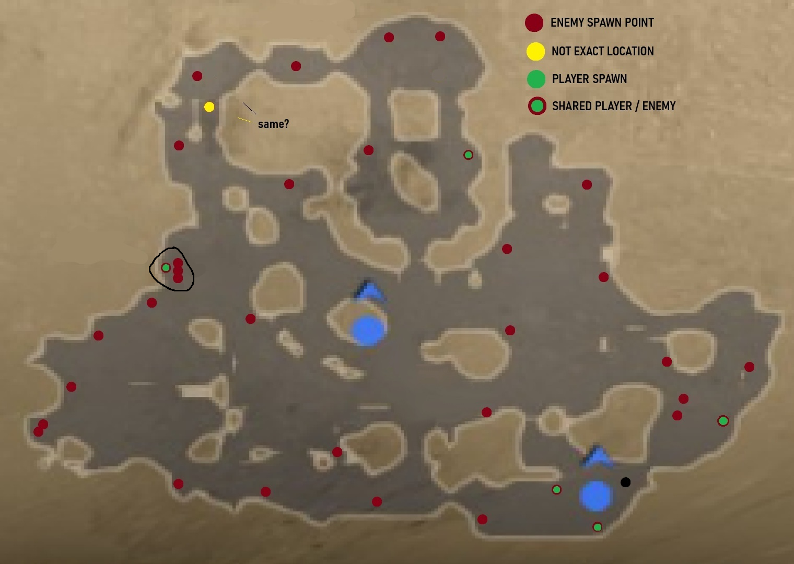
9. after popping your larva prime the enemies using your glaxion, then jump towards the endo spot and grab the endo using mag's pull
10. repeat steps 5-9 until the match ends

---

### Aksondal Guide

- Aksondal is used to prevent enemies from walking off so enemies can be pulled easier
1. after your khora kills the enemies start shooting your aksondal until you have 1 bullet left
2. when the enemies spawn, press r to reload (triggering the aksondal passive), then cast larva in the spot shown below

3. after the khora kills the enemies reload the aksondal to get back the entire magazine
4. repeat steps 1-3

# Nidus Gameplay

- [Example 1](https://medal.tv/games/warframe/clips/nIamITs6Xo2f9Wrn8?invite=cr-MSxsVDcsMTA3MDE3MzE4)
- [Aksondal](https://medal.tv/games/warframe/clips/nLUQDFMvSG4ahJGp8?invite=cr-MSxCSE0sMTA3MDE3MzE4)

---

## Khora Loadout

### Build

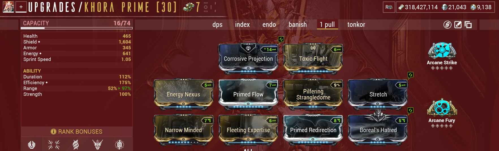

### Archon shards

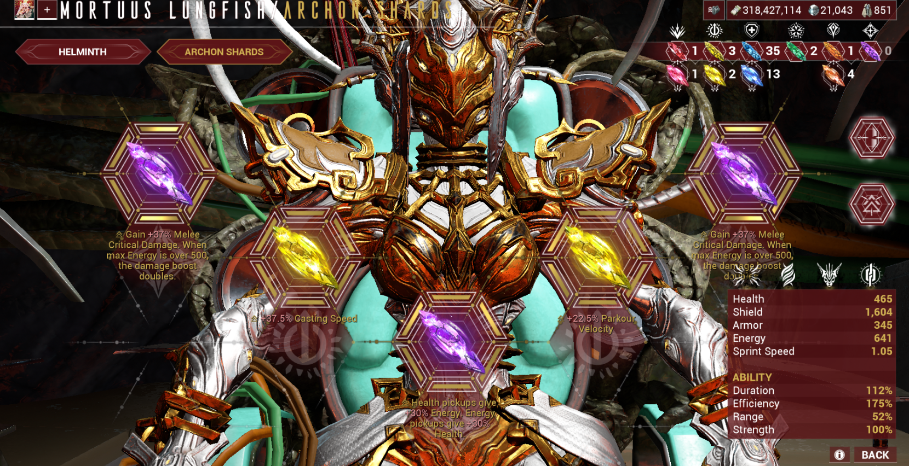

### Prisma Skana

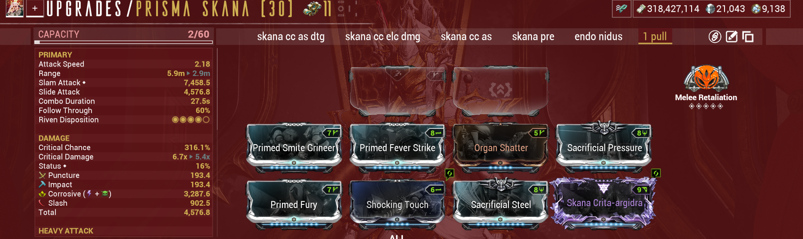

### Notes

- if you don't have the capacity to fit both sacrificial steel and pressure run galvanized pressure and primed pressure point instead
- your skana build will most likely change depending on your riven

---

# Khora Procedure

1. do rollout like normal
2. once you land on the bridge and place cage, go op, press 2 then sling and leave operator
3. kill the enemies when the appear in cage
4. grab the health orb in the lake area and move to this spot
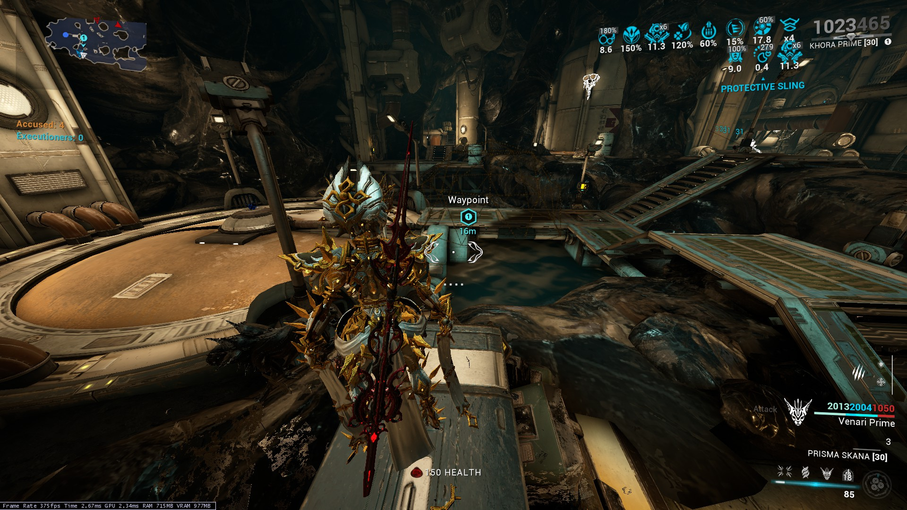
5. once the names disappear sling yourself, cast vazarin 2 in the middle of the spot
6. place cage
7. look in the green box on reinforcement modifier and the red box on non rein  
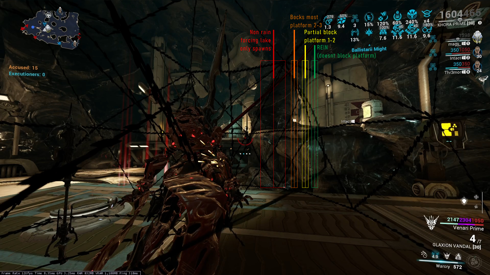
8. wait for the nidus to pull the enemies into the cage, and once you see them in front of you start attacking
9. make sure to chop the bodies then sling
10. repeat steps 5-9 until the run ends

---

# Khora Gameplay

- [Example 1](https://www.youtube.com/watch?v=C9IhJR7qRZY)
- The rollout done here is optional as it saves time, but requires more coordination and a higher chance you get one tapped on rollout

# Credits

[__**WFPedia's creators**__](https://wfpedia.com/posts/endo/basics) - Making an endo guide in the first place.

__**-oyo-**__ 
  Created guide template and inspired me to upload a guide to github.
__**Obliterate**__ , __**ZGB**__ , __**Psychocat**__ , __**Kirbo**__
  Helped test and brainstorm ideas for this strategy.

  https://discord.com/channels/1042561095094763644/1291677621914177567